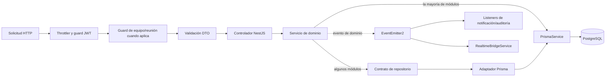

# Arquitectura implementada — MeetFlow

Este documento resume los límites de ejecución y dependencias del sistema
actual. El inventario detallado de dominios, rutas, páginas y servicios está en
el [mapa del sistema](./system-map.md); el modelo persistido está en
[base de datos](./database.md).

## Vista general

MeetFlow se compone de dos proyectos pnpm independientes, sin workspace:

- `frontend/`: Next.js 14 con App Router, TypeScript y React Query. Renderiza las
  páginas del navegador y consume HTTP REST y Socket.IO.
- `backend/`: NestJS 10, Prisma 6 y PostgreSQL 16. Es la fuente de verdad para
  autorización y reglas de negocio.
- `docker-compose.yml`: ejecuta `db`, `migrate`, `api` y `web`. Las migraciones
  se aplican mediante `prisma migrate deploy` antes de iniciar la API.

Los contratos compartidos (enums, permisos y tipos) se mantienen duplicados en
`backend/src/shared/` y `frontend/lib/shared/`. No hay paquete compartido ni
workspace pnpm.

## Flujo de una solicitud

En tiempo de ejecución el middleware asigna `X-Request-Id`; NestJS aplica el
`ThrottlerGuard`, `JwtAuthGuard`, pipe de validación, interceptor de respuesta y
filtro de excepciones globales. Los controladores reciben DTOs y usuario
actual, los servicios hacen verificaciones de negocio y Prisma accede a la base.
`MeetingAccessGuard` delega en `MeetingAccessService` la resolución del recurso
de reunión antes de verificar membresía y permisos.
Los módulos `meetings`, `teams`, `tasks`, `notes`, `decisions`, participantes y
agenda encapsulan los recursos de su dominio; `notifications`, `audit` y
`realtime` reaccionan a eventos internos cuando corresponde.

## Backend y límites de dominio

Los módulos se declaran en `backend/src/app.module.ts`. Cada módulo que usa
`PrismaService` importa `PrismaModule` de forma explícita; el proveedor de
persistencia no es global. `EventEmitterModule` se registra en el módulo raíz.
No hay message broker externo.

La consulta de membresía de equipo se concentra en `TeamsService`; guards y
servicios que requieren esa información consumen su API exportada en vez de
consultar `teamMember` directamente. Las consultas de recursos y filtros de
listado siguen perteneciendo a sus módulos.

`TeamAuthorizationService` centraliza la decisión de acceso por rol y acción.
Los guards resuelven el ámbito HTTP y delegan en ese servicio la validación de
membresía y permisos.

Los guards de autorización contextual pertenecen a los módulos de `teams` y
`meetings`; `common` conserva guards transversales como la autenticación JWT.

En el dominio de reuniones, `MeetingsService` depende del contrato
`MeetingsRepository`. `PrismaMeetingsRepository` implementa las consultas y se
inyecta desde `MeetingsModule`; las reglas de fechas, transiciones y conflictos
permanecen en el servicio. Este límite se aplica de forma selectiva, no como
una capa obligatoria para todos los módulos.

En tareas, `TasksService` consume `TasksRepository`, registrado en
`TasksModule` con `PrismaTasksRepository`. El repositorio concentra las
operaciones de persistencia y sus consultas Prisma. `TasksService` conserva las
reglas de negocio: membresía y rol del actor, pertenencia del responsable,
transiciones válidas de estado, normalización de valores de creación y emisión
de eventos de dominio. El repositorio no decide permisos ni transiciones.

En notas, `NotesService` consume `NotesRepository`, conectado a
`PrismaNotesRepository` desde `NotesModule`. El adaptador encapsula las consultas
Prisma, incluida la lectura que determina si el usuario participa en la reunión.
`NotesService` interpreta ese resultado y mantiene la regla de que solo un
participante puede crear una nota; también decide si una nota puede modificarse
o eliminarse (autor u organizador) y emite `note.created`/`note.updated` para los
listeners. El repositorio no aplica estas reglas de autorización ni publica
eventos.

El mismo límite se aplica a decisiones: `DecisionsService` conserva la regla de
participación para crear y la autoría/organización para modificar o borrar,
además de preparar el texto indexable y emitir `decision.created` y
`decision.updated`. `PrismaDecisionsRepository` concentra las consultas y
escrituras Prisma.

`AgendaService` mantiene la autorización por organizador/rol, la comprobación
del responsable de equipo y la validación de que el reordenamiento contenga
exactamente los puntos existentes. `PrismaAgendaRepository` realiza la
persistencia y ejecuta en una transacción la actualización de orden de todos los
puntos.

`ParticipantsService` conserva las reglas de gestión por organizador/rol, la
deduplicación y validación de las invitaciones, la protección del organizador y
el despacho de cambios en tiempo real. `PrismaParticipantsRepository` encapsula
las consultas y escrituras; la creación múltiple de participantes ocurre en una
transacción. La consulta de IDs que verifica que los invitados pertenecen al
equipo se delega en `TeamsService.findMemberUserIds`, para que la propiedad de
las membresías siga en el módulo de equipos.

| Área | Módulos | Límite principal |
|---|---|---|
| Identidad | `auth`, `users` | Credenciales, tokens, perfil y recuperación de cuenta. |
| Organización | `teams` | Membresías, roles y permisos asociados al equipo. |
| Reuniones | `meetings`, `participants`, `agenda`, `notes`, `decisions` | Reunión y recursos relacionados, con verificación de acceso contextual. |
| Seguimiento | `tasks`, `dashboard` | Compromisos por equipo y agregados de actividad. |
| Servicios de apoyo | `notifications`, `audit`, `search`, `attachments`, `assistant` | Avisos, registro, búsqueda, metadatos de archivos y sugerencias asistidas. |
| Operación | `realtime`, `health`, `prisma` | Canal push, comprobación de salud y acceso a persistencia. |

La tabla de rutas HTTP por módulo y los controladores concretos están en el
[mapa del sistema](./system-map.md#backend-dominios-y-módulos-nestjs).

## Frontend y acceso a datos

`frontend/app/` contiene las rutas reales del App Router. Las pantallas de la
aplicación llaman a `useRequireSession`, que obtiene el perfil con
`GET /users/me`, y se componen dentro de `AppShell`. El estado remoto se
administra con TanStack Query; las mutaciones llaman al cliente HTTP de
`frontend/lib/api/client.ts` y los resultados actualizan o invalidan la caché.

El access token se guarda en `sessionStorage`; las solicitudes mandan
`Authorization: Bearer` y `credentials: 'include'` para la cookie de refresh.
El mapa enumera las páginas existentes: no infiere rutas a partir de planes
anteriores.

## Eventos y tiempo real

Los servicios de negocio persisten mediante REST y, cuando aplica, emiten
EventEmitter2. Los listeners de notificación y auditoría escriben sus propios
registros; `RealtimeBridgeService` traduce eventos de dominio a mensajes Socket.IO.
El gateway vive en `/realtime`, valida el JWT del handshake y une el socket a
salas de usuario y equipos. El cliente puede entrar a una sala de reunión.

Socket.IO solo notifica cambios: no muta recursos ni sustituye las consultas
REST. El frontend invalida queries de React Query al recibir eventos y vuelve a
leer el estado del backend.

## Integraciones y estado real

- **PostgreSQL y Prisma:** persistencia relacional, migraciones en
  `backend/prisma/migrations/`.
- **Archivos:** el proveedor local guarda archivos en disco. `S3StorageService`
  es actualmente un stub y no conecta con AWS/S3.
- **Asistente:** la selección del proveedor contempla `GEMINI_API_KEY`, pero los
  proveedores Gemini y fake actuales devuelven resultados de muestra; la
  integración con el modelo no está implementada.
- **Inyección de integraciones:** almacenamiento y asistente usan tokens
  `Symbol` y proveedores registrados en NestJS. La configuración selecciona
  una implementación ya administrada por el contenedor.
- **Correo:** hay variables SMTP configurables, pero no existe un servicio de
  correo conectado a las operaciones.
- **CORS:** `main.ts` comparte los orígenes permitidos con el adaptador Socket.IO.

Estas limitaciones describen el código actual; las variables de entorno o
módulos configurables no implican que la integración externa esté activa.

## Configuración y ejecución

Cada proyecto mantiene su propio `.env`, derivado de su `.env.example`. La API
carga la configuración del paquete `backend/`; el frontend toma
`NEXT_PUBLIC_API_URL` durante el build. El puerto HTTP por defecto es 3000 y el
frontend local se sirve en 3001. La configuración completa y los comandos están
en el [README](../README.md).

`GET /health` comprueba la base de datos además del proceso. Swagger está en
`GET /api/docs` si `SWAGGER_ENABLED` lo permite. Los controladores no aplican un
prefijo global a las rutas REST.
