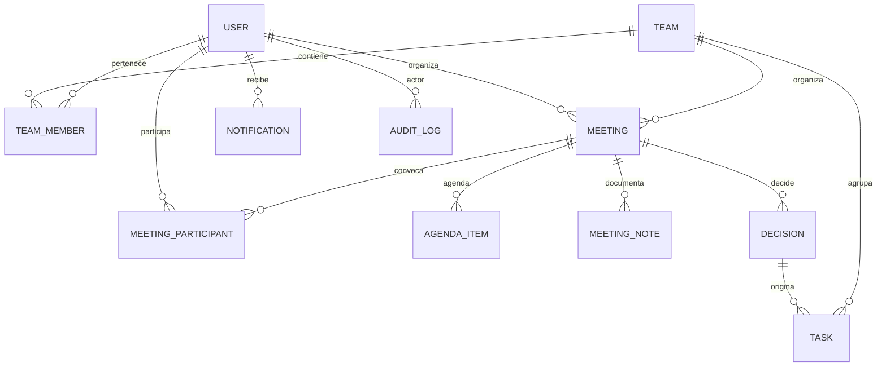

# Base de datos — MeetFlow

Este documento resume el schema activo de
[`backend/prisma/schema.prisma`](../backend/prisma/schema.prisma). Prisma y sus
migraciones versionadas son la fuente de cambios de estructura; no se editan
las tablas manualmente.

## Motor y convenciones

- PostgreSQL 16 y Prisma ORM 6.
- Los modelos usan `cuid()` como ID por defecto, salvo tokens de sesión que
  también tienen un identificador de familia UUID.
- Los nombres SQL se mapean principalmente a `snake_case` con `@@map` y
  `@map`; en el cliente Prisma se usan nombres `camelCase`.
- PostgreSQL aloja índices GIN y columnas `tsvector` que se mantienen mediante
  migraciones SQL, ya que el schema Prisma declara esos campos como
  `Unsupported("tsvector")`.
- Las migraciones están en `backend/prisma/migrations/` y se aplican con los
  scripts `db:migrate` (desarrollo) y `db:deploy` (despliegue).

## Modelos actuales

| Modelo | Tabla | Responsabilidad y relaciones principales |
|---|---|---|
| `User` | `users` | Cuenta, nombre, alias, teléfono, zona horaria, locale, estado y perfil. Se relaciona con equipos, reuniones, tareas, notificaciones, auditoría y tokens. |
| `RefreshToken` | `refresh_tokens` | Refresh token almacenado como hash, expiración, revocación y `tokenFamily` para rotación/reutilización. Pertenece a un usuario. |
| `PasswordResetToken` | `password_reset_tokens` | Hash de token de restablecimiento, expiración y fecha de uso; pertenece a un usuario. |
| `Team` | `teams` | Equipo con propietario, miembros, reuniones y tareas. |
| `TeamMember` | `team_members` | Relación usuario-equipo y rol. Tiene unicidad compuesta por `teamId` y `userId`. |
| `Meeting` | `meetings` | Reunión con equipo, organizador, estado, intervalo horario, zona horaria, ubicación y enlace. Contiene participantes, agenda, notas, decisiones, tareas y adjuntos. |
| `MeetingParticipant` | `meeting_participants` | Vínculo entre reunión y usuario, con estado de respuesta y asistencia registrada. Un usuario aparece una sola vez por reunión. |
| `AgendaItem` | `agenda_items` | Punto ordenado de la agenda; puede tener duración y responsable. |
| `MeetingNote` | `meeting_notes` | Nota escrita por un usuario. `meetingId` es nullable y pasa a `NULL` al eliminar la reunión para conservar la nota. |
| `Decision` | `decisions` | Decisión con título, contenido opcional y autor. `meetingId` nullable para conservarla al borrar la reunión. Puede originar tareas. |
| `Task` | `tasks` | Compromiso asociado a equipo, opcionalmente a reunión/decisión y persona asignada; registra creador, estado, prioridad y vencimiento. |
| `Attachment` | `attachments` | Metadatos y clave del archivo, con relación opcional a reunión, nota o tarea. Los bytes viven en el proveedor de almacenamiento. |
| `Notification` | `notifications` | Aviso por usuario, tipo, texto, estado de lectura y metadatos JSON. |
| `AuditLog` | `audit_logs` | Acción, entidad, usuario, origen de petición y metadatos para auditoría. |

## Enums

- `TeamRole`: `OWNER`, `ADMIN`, `MEMBER`, `GUEST`.
- `MeetingStatus`: `DRAFT`, `SCHEDULED`, `IN_PROGRESS`, `COMPLETED`, `CANCELLED`.
- `ParticipantStatus`: `INVITED`, `ACCEPTED`, `DECLINED`, `TENTATIVE`.
- `AttendanceStatus`: `ATTENDED`, `ABSENT`.
- `TaskStatus`: `TODO`, `IN_PROGRESS`, `BLOCKED`, `DONE`, `CANCELLED`.
- `TaskPriority`: `LOW`, `MEDIUM`, `HIGH`, `URGENT`.
- `NotificationType`: `MEETING_INVITATION`, `MEETING_UPDATED`,
  `MEETING_CANCELLED`, `MEETING_REMINDER`, `TASK_ASSIGNED`, `TASK_DUE_SOON`,
  `TASK_OVERDUE`, `MENTION`, `DECISION_CREATED`.
- `AuditAction`: `USER_LOGIN`, `USER_LOGOUT`, `MEETING_CREATED`,
  `MEETING_UPDATED`, `MEETING_CANCELLED`, `MEMBER_INVITED`, `MEMBER_REMOVED`,
  `TASK_CREATED`, `TASK_UPDATED`, `TASK_COMPLETED`, `DECISION_CREATED`.
- `AuditEntity`: `USER`, `MEETING`, `TEAM`, `TASK`, `DECISION`.

## Relaciones y retención

`MeetingNote.meetingId` y `Decision.meetingId` usan `onDelete: SetNull`, para
retener el contenido si se elimina la reunión. Los participantes y puntos de
agenda dependen de su reunión; su relación se elimina en cascada. Tareas pueden
permanecer sin reunión o decisión (`SetNull`), pero se eliminan en cascada al
borrar el equipo. Los adjuntos se eliminan en cascada junto con su recurso
asociado según las relaciones declaradas en el schema.

## Búsqueda de texto completo

`User`, `Meeting`, `MeetingNote`, `Decision` y `Task` declaran `searchVector`
como `tsvector` no administrado por Prisma y tienen índices GIN. La migración de
búsqueda instala triggers y realiza el mantenimiento del vector con la
configuración española. El módulo `search` compone SQL parametrizado y restringe
los resultados a equipos a los que pertenece el usuario.

## Fuente de verdad y evolución

La tabla anterior resume el schema presente; el historial de creación y cambios
está en las migraciones SQL. Para proponer una modificación, cambia el schema
Prisma y genera una migración desde `backend/`; no uses esta página como
instrucción para alterar una base activa a mano.
