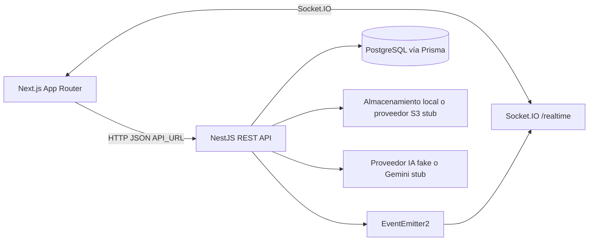
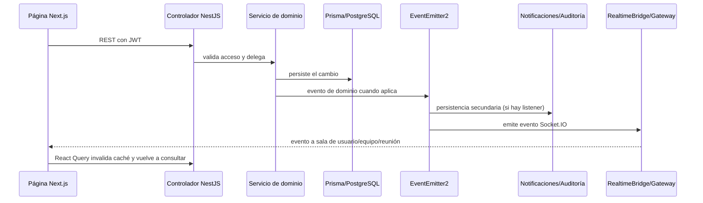

# Mapa del sistema — MeetFlow

Este documento describe la implementación presente en `backend/`, `frontend/`
y `backend/prisma/schema.prisma`. Las rutas REST se contrastan con los
controladores; la especificación OpenAPI generada por la aplicación en
`GET /api/docs` es la referencia de ejecución.

## Límites y composición

MeetFlow tiene dos paquetes pnpm independientes. El frontend Next.js consume la
API REST y el namespace Socket.IO `/realtime`; NestJS aplica las reglas de
negocio y Prisma accede a PostgreSQL. Los tipos, enums y permisos compartidos
están duplicados a propósito en `backend/src/shared/` y `frontend/lib/shared/`.

La API no fija un prefijo global: las rutas indicadas abajo se sirven desde la
raíz del host. `API_PREFIX` se carga en configuración, pero `main.ts` no lo
aplica con `setGlobalPrefix`.

## Backend: dominios y módulos NestJS

`AppModule` registra los módulos de dominio y componentes transversales. La
mayoría de los servicios de dominio leen y escriben mediante `PrismaService`;
cada módulo consumidor importa `PrismaModule` de forma explícita. Los
controladores convierten entradas HTTP y delegan operaciones en servicios;
algunos módulos además usan presenters para dar forma a las respuestas.
La consulta de membresía se delega a `TeamsService`, consumido por los guards
y servicios que aplican permisos de equipo.

| Módulo | Responsabilidad implementada | Rutas principales |
|---|---|---|
| `auth` | Registro, login, refresh rotatorio, logout, recuperación y cambio de contraseña. Coordina `UsersService`, JWT, bcrypt, tokens y eventos de auditoría. | `/auth/*` |
| `users` | Perfil del usuario autenticado y actualización de sus datos. | `/users/me` |
| `teams` | Equipos, membresías, roles, invitaciones a cuentas existentes, salida y transferencia de propiedad. | `/teams/*` |
| `meetings` | Ciclo de vida de reuniones, filtros por equipo, transiciones de estado y acceso al recurso. | `/meetings/*` |
| `participants` | Invitación a participantes, respuesta de asistencia y registro de asistencia real. | `/meetings/:id/participants/*` |
| `agenda` | Creación, edición, eliminación y reordenamiento de puntos de agenda. | `/meetings/:id/agenda`, `/agenda/:itemId` |
| `notes` | Notas de reunión; se conservan desvinculadas si la reunión se elimina. | `/meetings/:id/notes`, `/notes/:id` |
| `decisions` | Decisiones vinculables a una reunión; se conservan desvinculadas al borrar la reunión. | `/meetings/:id/decisions`, `/decisions/:id` |
| `tasks` | Tareas por equipo, asignación, estado, prioridad, vencimiento y filtros. | `/tasks/*` |
| `dashboard` | Agregados de reuniones y tareas visibles para el usuario. | `/dashboard` |
| `notifications` | Bandeja, lectura, menciones y barridos programados para recordatorios y vencimientos. | `/notifications/*` |
| `audit` | Consulta de eventos persistidos y filtrados por acceso del usuario. | `/audit` |
| `search` | Búsqueda PostgreSQL de texto completo, acotada a equipos del usuario. | `/search` |
| `attachments` | Metadatos de adjuntos y delegación de bytes al proveedor de almacenamiento. | `/attachments/*` |
| `assistant` | Fachada que comprueba pertenencia al equipo antes de solicitar resúmenes o sugerencias. | `/assistant/*` |
| `realtime` | Autenticación de sockets, presencia y emisión a salas personales, de equipo y reunión. No expone rutas REST. | Socket.IO `/realtime` |
| `health` | Estado del proceso y comprobación de PostgreSQL. | `GET /health` |

Los componentes transversales registrados en `AppModule` son `RequestIdMiddleware`,
`ThrottlerGuard`, `JwtAuthGuard`, `TransformResponseInterceptor` y
`AllExceptionsFilter`. `configureApp` instala `ValidationPipe` con whitelist,
transformación y rechazo de propiedades no permitidas. `TeamRoleGuard` y
`MeetingAccessGuard` añaden autorización contextual en los controladores que
los declaran. La autorización de negocio también se verifica en los servicios
cuando la operación lo requiere.

`MeetingAccessGuard` obtiene el ámbito de reunión mediante
`MeetingAccessService`, que resuelve reuniones, notas, decisiones y puntos de
agenda a su reunión asociada. El guard aplica la membresía y la acción del rol;
el servicio encapsula las consultas Prisma de resolución.
La autorización de equipos se decide en `TeamAuthorizationService`, que combina
la membresía obtenida por `TeamsService` con la matriz `roleCan`.

## Rutas REST implementadas

Todos los paths son relativos a la raíz de la API, sin `/api` delante. Salvo
`GET /`, `GET /health` y las operaciones de autenticación marcadas como
públicas, requieren el JWT de acceso. El guard global determina el acceso
público con `@Public`; los endpoints de equipos y reuniones aplican además sus
guards contextuales.

| Dominio | Método y ruta | Acceso |
|---|---|---|
| Aplicación | `GET /` | Público |
| Salud | `GET /health` | Público |
| Autenticación | `POST /auth/register`, `POST /auth/login`, `POST /auth/refresh`, `POST /auth/logout`, `POST /auth/forgot-password`, `POST /auth/reset-password` | Público |
| Autenticación | `POST /auth/change-password` | JWT |
| Usuarios | `GET /users/me`, `PATCH /users/me` | JWT |
| Equipos | `POST /teams`, `GET /teams`, `GET /teams/:teamId`, `PATCH /teams/:teamId`, `DELETE /teams/:teamId` | JWT; autorización de equipo según operación |
| Miembros | `POST /teams/:teamId/members`, `PATCH /teams/:teamId/members/:memberId`, `DELETE /teams/:teamId/members/:memberId`, `POST /teams/:teamId/leave`, `POST /teams/:teamId/transfer-ownership` | JWT; autorización de equipo según operación |
| Reuniones | `POST /meetings`, `GET /meetings`, `GET /meetings/:id`, `PATCH /meetings/:id`, `DELETE /meetings/:id` | JWT; acceso al equipo/reunión |
| Participantes | `GET /meetings/:id/participants`, `POST /meetings/:id/participants`, `PATCH /meetings/:id/participants/me`, `PATCH /meetings/:id/participants/:userId/attendance`, `DELETE /meetings/:id/participants/:userId` | JWT; acceso a reunión |
| Agenda | `GET /meetings/:id/agenda`, `POST /meetings/:id/agenda`, `PATCH /meetings/:id/agenda/reorder`, `PATCH /agenda/:itemId`, `DELETE /agenda/:itemId` | JWT; acceso a reunión |
| Notas | `GET /meetings/:id/notes`, `POST /meetings/:id/notes`, `PATCH /notes/:id`, `DELETE /notes/:id` | JWT; acceso a reunión |
| Decisiones | `GET /meetings/:id/decisions`, `POST /meetings/:id/decisions`, `PATCH /decisions/:id`, `DELETE /decisions/:id` | JWT; acceso a reunión |
| Tareas | `GET /tasks`, `POST /tasks`, `GET /tasks/:id`, `PATCH /tasks/:id`, `DELETE /tasks/:id` | JWT |
| Dashboard | `GET /dashboard` | JWT |
| Notificaciones | `GET /notifications`, `PATCH /notifications/:id/read`, `PATCH /notifications/read-all` | JWT |
| Búsqueda | `GET /search` | JWT |
| Auditoría | `GET /audit` | JWT |
| Adjuntos | `POST /attachments`, `GET /attachments/:id`, `DELETE /attachments/:id` | JWT |
| Asistente | `POST /assistant/summarize-meeting`, `POST /assistant/suggest-agenda`, `POST /assistant/summarize-tasks` | JWT; pertenencia al equipo para datos de reunión/equipo |

El inventario suma **61 operaciones REST** según los decoradores HTTP en los
controladores. No incluye eventos de Socket.IO. El interceptor envuelve valores
de éxito en `{ data }`; si un controlador devuelve `message` o un objeto con
`meta`, esos campos se conservan. La definición detallada en ejecución está en
Swagger.

## Frontend: páginas del App Router

Las rutas se derivan de los archivos `page.tsx` existentes; los segmentos entre
paréntesis son grupos de organización y no aparecen en la URL.

| URL | Archivo | Propósito |
|---|---|---|
| `/` | `frontend/app/page.tsx` | Página de presentación y acceso a la aplicación. |
| `/login` | `frontend/app/(auth)/login/page.tsx` | Inicio de sesión. |
| `/register` | `frontend/app/(auth)/register/page.tsx` | Registro de cuenta. |
| `/dashboard` | `frontend/app/dashboard/page.tsx` | Resumen de actividad. |
| `/calendar` | `frontend/app/calendar/page.tsx` | Vista de calendario de reuniones. |
| `/meetings` | `frontend/app/meetings/page.tsx` | Lista de reuniones. |
| `/meetings/new` | `frontend/app/meetings/new/page.tsx` | Creación de reunión. |
| `/meetings/:id` | `frontend/app/meetings/[id]/page.tsx` | Detalle, participantes, agenda, notas y decisiones. |
| `/meetings/:id/edit` | `frontend/app/meetings/[id]/edit/page.tsx` | Edición de reunión. |
| `/tasks` | `frontend/app/tasks/page.tsx` | Lista y gestión de tareas. |
| `/teams` | `frontend/app/teams/page.tsx` | Lista y creación de equipos. |
| `/notifications` | `frontend/app/notifications/page.tsx` | Bandeja de notificaciones. |

Las páginas de aplicación usan `useRequireSession` y `AppShell`; el hook consulta
`GET /users/me` mediante TanStack Query y redirige a `/login` si no hay token.
No existe actualmente una página `/forgot-password`, de configuración o de
administración independiente.

## Servicios e integraciones

| Servicio o integración | Uso y estado verificado |
|---|---|
| Prisma / PostgreSQL | `PrismaService` se provee mediante `PrismaModule`, importado explícitamente por cada consumidor; el esquema activo está en `backend/prisma/schema.prisma` y las migraciones versionadas. |
| EventEmitter2 | Eventos internos conectan cambios de dominio con notificaciones, auditoría y realtime; no hay broker externo. |
| Notificaciones | `NotificationsService` persiste en PostgreSQL; `MentionsListener` procesa menciones; `NotificationSchedulerService` ejecuta barridos periódicos de recordatorios y tareas. No hay envío de correo conectado. |
| Socket.IO | Namespace `/realtime`, JWT en handshake, salas `user:<id>`, `team:<id>` y `meeting:<id>`. Solo emite avisos; las mutaciones siguen pasando por REST. |
| Almacenamiento | `STORAGE_DRIVER=local` escribe archivos localmente. `GET /attachments/:id` devuelve metadatos, no los bytes. La clase `S3StorageService` es un stub: no integra un SDK S3 ni persiste bytes en S3. |
| Asistente | El módulo selecciona proveedor por `GEMINI_API_KEY`, pero `GeminiAssistantService` y `FakeAssistantService` devuelven respuestas de muestra; no hay llamada Gemini implementada. La fachada valida membresía para resúmenes de reunión/equipo. |
| Correo | Hay configuración SMTP en el entorno, pero no existe servicio de correo conectado a los flujos actuales. Recuperación de contraseña no debe documentarse como email entregado. |
| Cliente API frontend | `frontend/lib/api/client.ts` configura `NEXT_PUBLIC_API_URL`, `credentials: 'include'`, JSON y `Authorization: Bearer`; guarda el access token en `sessionStorage`. |
| Estado frontend | TanStack Query mantiene caché y vuelve a consultar; los eventos realtime invalidan queries en lugar de ser la fuente de datos. |

## Flujos entre capas

### Autenticación

1. La página de login o registro llama a `authApi` en `frontend/lib/api/entities.ts`.
2. El cliente HTTP incluye credenciales y el backend valida DTOs con el pipe global.
3. `AuthService` usa `UsersService`, bcrypt, `JwtService` y Prisma. En login emite
   eventos internos para auditoría.
4. La API devuelve el access token en el cuerpo y establece el refresh token como
   cookie `HttpOnly`; el frontend guarda el access token en `sessionStorage` y
   lo envía como Bearer en solicitudes posteriores.
5. `useSession` comprueba la sesión consultando `GET /users/me`.

### Cambios de reunión y actualización de interfaz

Los listeners no sustituyen la persistencia del recurso. Los eventos de dominio
se despachan después del cambio correspondiente; fallos de notificación o
auditoría se registran y no revierten la operación de negocio.

### Datos de la reunión

El detalle de reunión compone consultas REST a reuniones, participantes, agenda,
notas y decisiones. Estos recursos son módulos separados con sus propios
controladores y servicios. Las notas y decisiones pueden quedar con `meetingId`
nulo cuando se elimina la reunión; los adjuntos tienen rutas propias y su
almacenamiento físico se delega al servicio seleccionado.

## Fuentes para ampliar

- [Arquitectura](./architecture.md): composición y límites de capas.
- [Contrato REST](./api.md): envolturas, errores y enlace al catálogo.
- [Modelo de datos](./database.md): modelos y relaciones Prisma actuales.
- [Flujos de usuario](./user-flows.md): recorridos funcionales descritos.
- Código backend: `backend/src/app.module.ts`, `backend/src/modules/` y
  `backend/src/health/`.
- Código frontend: `frontend/app/`, `frontend/lib/api/` y `frontend/lib/auth/`.
